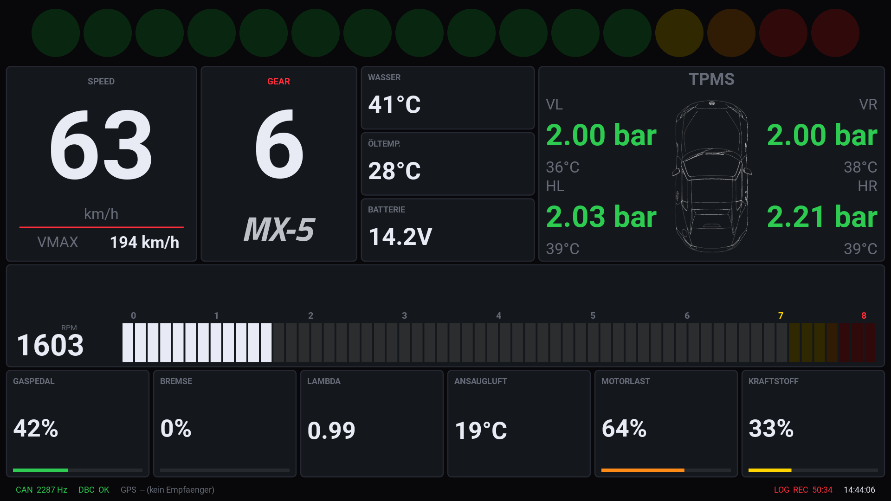

# Pi-Laufzeitstatus: was läuft gerade auf dem Auto-Pi

Momentaufnahme des tatsächlichen Zustands auf dem Raspberry Pi im Auto. Die Ersteinrichtung und
Reproduzierbarkeit beschreibt [`../../scripts/pi-config/SETUP.md`](../../scripts/pi-config/SETUP.md).
**Bei jedem Umbau auf dem Pi in-place aktualisieren.** Den laufenden Code-Stand zeigt das Git auf dem Pi
(siehe unten). Ältere Stände bis 28.09. sind ins Logbuch ausgelagert, siehe `logs/can-bus-status.md`,
„Pi-Infrastruktur: Lücken zu Hause reproduziert…“ (10.10.2026).

**Stand 2026-10-10, ~23:50** (per SSH geprüft, Pi zu Hause ohne CAN-Adapter, nach dem Stick-Tausch):
- Deploy: `deployed` = Kopf von Branch `gzip-hintergrund-2026-10-10` (PR #45, noch nicht in `main`), zuletzt `bce5930` (Dash: Log-Auswahl, ganze Logs in der Simulation).
- `throttled=0x0`, keine failed units, `/media/root-ro` ro, Stick 2,7 GB belegt, 106 GB frei.
- Alle Fahrt-Logs gepackt. Repo-Kopien der Overlay-Dateien sind identisch mit dem Unterbau.

## Hardware

Pi 4B Rev 1.5 (1,8 GB RAM), Hostname `car`, `pi@192.168.0.247`, Kernel 6.12.109. DS3231-RTC seit 28.09.
CANable 2.0 an `can0`, steckt nur im Auto. SD-Karte 64 GB mit overlayroot, also ro und mit RAM-Overlay.
`/home/pi/canlogs` liegt seit 10.10. auf einem SanDisk Ultra Flair 128 GB (ext4, Label `canlogs`) im blauen
USB-3-Port, `write()` max. 0,02 s. Der alte USB-2.0-Werbestick hing beim Schreiben bis 3 s, er ist als Backup
aufbewahrt. candump behält den 16-MiB-Empfangspuffer (~13 s) als Reserve, siehe Logbuch 10.10.
Der Pi sitzt auf der Rückseite des 10,1"-Displays („10.1inch LCD Display-H“), Strom kommt im Auto noch von
einer Powerbank. Eine USV ist geplant, siehe Logbuch 10.10. „USV-Recherche“.

## Prozesse und Dienste

| Was | gestartet von | läuft | Ausgabe |
|---|---|---|---|
| `can_backend.py` (Decode-Daemon, UDP-Snapshot Port 51234, sendet selbst nichts) | labwc-`autostart` → `respawn.sh` | immer | `applogs/can_backend.log` |
| `dash_gui.py` (Kivy-Frontend; Touch nur einfach seit 10.10., `mouse,disable_on_activity`) | labwc-`autostart` → `respawn.sh` | immer | `applogs/dash_gui.log` |
| `can-logger.service` → `session_logger.py` (KeyState-Trigger, Kernelfilter auf 0x050) | udev, `BindsTo` `can0` | solange der Adapter steckt | Journal (volatile) |
| └ `candump -l -r 16777216 can0` | `session_logger`, KeyState ≠ OFF | Zündung an | `candump-*.log`, `clockstate-*`, `ifstats-*` (minütlich) |
| └ `tpms_poller.py --interval 120` (TPMS, Öl, Lambda/ETC/Klopfen per OBD/UDS) | dito | Zündung an | landet im candump |
| `canlogs-pack.timer` → `canlogs-pack.service` (`session_logger.py --pack`) | `timers.target` | 10 min nach dem Boot, dann alle 15 min | Journal |
| `wlan-watchdog.timer` | `timers.target` | alle 15 s | – |

- **Packen:** nur `candump-*.log` und nur, solange kein candump läuft. Fährt man währenddessen los, stoppt
  `session_logger` den Packdienst, die Rohdatei bleibt heil. Ein 600-MB-Log braucht ~1 min.
- **`tpms_poller.py`** schickt die Schnellabfragen (PID 0x11/0x44/0x10, DID 0x03EC), deren Antworten Dash und
  Log zeigen. Ohne Handy-Dongle laufen sie ungebremst (~150 Anfragen/s auf 0x7E0). Sieht er fremde Tester-Anfragen,
  sind es 5 Runden/s (`FAST_PERIOD_SHARED_S`).
- **Vcan-Simulation** (Knopf auf dem Status-Bildschirm, wenn kein `can0` da ist): spielt das in der Liste
  daneben gewählte Log (Standard: neuestes) komplett und in Schleife ab und zeigt den Fahrbildschirm. Gestreamt
  per `zcat | canplayer -s 5`, nichts landet in `/tmp`. Beenden über „SIMULATION BEENDEN“ in dessen Fußzeile.
- Neustart nach einem Deploy: nur die Python-PID beenden, `respawn.sh` startet nach 2 s neu (nicht
  `pkill -f dash_gui.py`, das trifft auch die Schleife). `session_logger` startet beim nächsten Einstecken des
  Adapters, im Auto genügt `sudo systemctl restart can-logger`.



## `/home/pi/canlogs` (Stick)

- **Fahrtdaten** (die Pipeline holt sie per `find -maxdepth 1`): `candump-*.log(.gz)`, `clockstate-*.txt`,
  `clockjump-*.txt`, `ifstats-*.txt`.
- **Symlinks ins Repo:** `can_backend.py`, `dash_gui.py`, `session_logger.py`, `status_gui.py`, `tpms_poller.py`,
  `uds_did_sweep.py`, `test_*.py`, `mx5_top_view.png`, `fonts/`, `respawn.sh`, beide HSCAN-DBC.
- `repo/` (Git-Checkout, Branch `deployed`), `venv/`, `applogs/` (rotiert bei 5 MB beim Neustart),
  `boot_timing.log` (Dash-Erstframe je Boot), `last_known_time` (Uhr-Anker).
- `archiv/`: alte Backups (`backup-*`), Vorversionen und Ausgaben bis 10.10. Nichts davon wird im Betrieb gebraucht.

## Deploy-Stand = Git auf dem Pi

`/home/pi/canlogs/repo` ist ein Git-Checkout (Branch `deployed`). Deploy per `git push car HEAD:deployed`, der
`pre-push`-Hook verlangt, dass der Commit schon auf GitHub liegt. Einrichtung und Regeln:
[`../../scripts/pi-config/SETUP.md`](../../scripts/pi-config/SETUP.md), „Deploy per Git“.

```bash
ssh pi@192.168.0.247 'cd canlogs/repo && git log --oneline -1 && git status --short'
```

Ist die `git status`-Ausgabe leer, läuft der Pi exakt mit dem angezeigten Commit.

**Nicht im Git-Checkout** (Overlay-Unterbau, per `overlayroot-chroot`): labwc-`autostart`,
`can-logger.service`, udev-Regel, `wlan-watchdog.*`, `canlogs-pack.*`, `config.txt`. Die Repo-Kopien liegen in
`scripts/pi-config/`, der Abgleich geht von Hand (zuletzt 10.10.: identisch).

## Uhr

DS3231-RTC: Der Kernel stellt die Zeit beim Boot, fake-hwclock ist aus. `session_logger.py` schreibt den
Uhr-Zustand (`ntp`/`rtc`/…) je Fahrt in `clockstate-*.txt` und NTP-Sprünge als `clockjump-*.txt`. Dash-Fußzeile:
`NTP SYNC` bzw. `RTC OK` in Grün, `UHR ?` in Rot. Der Haltetest der Knopfzelle (kalter Stromausfall, Boot ohne
Netz) steht noch aus.
